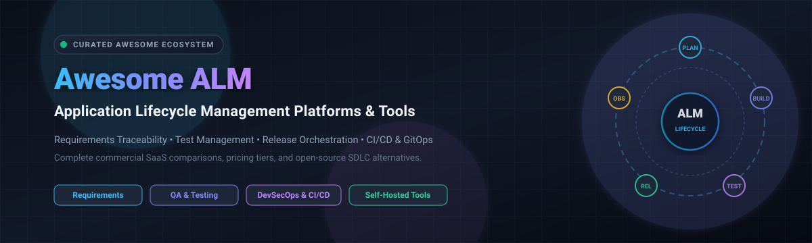

# Awesome Application Lifecycle Management (ALM) 🔄 📊

  

  
  
  
  
  
  

---

## 🌟 Top Application Lifecycle Management (ALM) Ecosystem

**Curated List of Commercial ALM Platforms & Open-Source Development Lifecycle Tools**  
*Focused on Requirements Management, Test Management, Release Orchestration, Traceability, CI/CD Integration, Software Development Lifecycle (SDLC), and Self-Hosted ALM Systems.*

**Last updated: October 2026** 📅

---

### 📌 Overview & SEO Summary

Welcome to the ultimate curated directory of **Application Lifecycle Management (ALM) platforms**, **open-source ALM frameworks**, and **software development lifecycle (SDLC) tools**. Application Lifecycle Management integrates governance, requirements analysis, project planning, software architecture, automated testing, quality assurance (QA), continuous integration and continuous delivery (CI/CD), and operational observability into a unified workflow.

Whether you are evaluating enterprise-grade commercial ALM suites (*Microsoft Azure DevOps*, *Salesforce Lifecycle Center*, *IBM Apptio Targetprocess*, *Siemens Polarion ALM*, *Atlassian Jira Software*, *GitLab*, *OpenText ALM*) or self-hostable open-source ALM alternatives (*Plane*, *Gitea*, *Backstage*, *Argo CD*, *OpenProject*, *Taiga*, *Keptn*), this repository provides comprehensive pricing comparisons, free-tier limits, market valuations, and GitHub star metrics to optimize your software delivery and regulatory compliance.

**Key Market Context & Insights:**
- **Market Sizing & Dynamics:** The global Application Lifecycle Management (ALM) market is estimated at **$4.7B – $6.2B**, expanding at a steady CAGR of ~8–10%. The sector is **moderately fragmented**, anchored by heavyweight hyperscalers and DevOps giants while leaving significant room for specialized requirements traceability suites, GitOps orchestrators, and developer portals.
- **ALM vs. DevOps Convergence:** ALM oversees strategic planning, compliance, requirements, and test governance across the application lifespan, whereas DevOps automates continuous integration, infrastructure as code, and runtime delivery. Together, they establish complete end-to-end traceability across Plan, Build, Test, Release, and Observe stages.
- **Enterprise Shifts:** Platforms like Salesforce have consolidated application governance under **Salesforce Lifecycle Center**, while Kubernetes-native organizations leverage CNCF orchestrators like **Keptn** and internal developer platforms like Spotify's **Backstage**.
- **Regulated Industries:** Systems engineering and medical/automotive compliance standards (ISO 26262, IEC 62304, DO-178C) rely heavily on specialized requirements management platforms such as **Siemens Polarion ALM**, **Perforce Helix ALM**, and **Jama Connect**.

---

## 📑 Table of Contents
- [🏢 SaaS & Commercial Platforms](#-saas--commercial-platforms)
- [🔓 Open-Source GitHub Projects](#-open-source-github-projects)
- [🛠️ How to Contribute](#%EF%B8%8F-how-to-contribute)
- [📊 Star History](#-star-history)
- [🤝 Support & Sponsorship](#-support--sponsorship)
- [⚠️ Disclaimer](#%EF%B8%8F-disclaimer)

---

## 🏢 SaaS & Commercial Platforms

> The global Application Lifecycle Management (ALM) market is estimated at **$4.7B – $6.2B** with an 8–10% CAGR; the sector is **moderately fragmented**, balancing dominant hyperscalers (Microsoft, Salesforce, IBM) with specialized requirements, compliance, and test management providers.

The commercial ALM ecosystem spans enterprise suites (*Polarion ALM*, *Helix ALM*, *OpenText ALM Quality Center*), integrated DevSecOps platforms (*Azure DevOps*, *GitLab*, *Jira Software*), and specialized requirements traceability systems (*Jama Connect*, *Targetprocess*, *XQual*).

| SaaS / Commercial Platform | Company / Owner | Valuation / Market Cap | Standard Starting Price | Free Tier / Free Trial Limits | Description |
| :--- | :--- | :--- | :--- | :--- | :--- |
| **[Azure DevOps](https://azure.microsoft.com/en-us/products/devops/)** 🔷 | Microsoft | ~$3.90 Trillion | **$6.00 / user / month** (Basic Plan) | **Free tier forever: up to 5 users** (includes unlimited private Git repos, Azure Boards work item tracking, and 1,800 free CI/CD build minutes/month) | **Microsoft-native enterprise ALM** — End-to-end suite combining Azure Boards (agile work tracking), Azure Repos (Git), Azure Pipelines (CI/CD), Azure Test Plans, and Azure Artifacts with Visual Studio & GitHub integration. |
| **[Salesforce Lifecycle Center](https://www.salesforce.com/platform/enterprise-app-development/application-lifecycle-management-ALM/)** ☁️ | Salesforce | ~$250 Billion | **$25.00 / user / month** (Starter Suite) | **Free tier: included with Salesforce CRM subscription** (no extra license cost for existing Salesforce enterprise seats) | **Enterprise ALM for Salesforce** — Governance, change and release management, and real-time analytics in one place. Includes DX Inspector for metadata deployments and Lifecycle Center Governance for coding agents. |
| **[Targetprocess](https://www.targetprocess.com/)** 🟢 | Apptio (IBM) | ~$200 Billion (IBM) | **$16.00 / user / month** (Standard Plan) | **30-day free trial** (custom guided evaluation sandbox with sample enterprise portfolio data) | **Agile portfolio & ALM platform** — Scaled Agile Framework (SAFe) support, value stream management, visual project planning, and roadmapping for complex enterprise software initiatives. |
| **[Polarion ALM](https://polarion.software/)** 🏢 | Siemens | ~$60 Billion | **$42.00 / user / month** (Polarion X Base) | **30-day free trial** (full access with pre-configured project templates and tutorials) | **Regulated enterprise ALM** — Live requirements traceability, test management, hazard analysis, and audit trails tailored for automotive (ISO 26262), aerospace, and medical device compliance. |
| **[Jira Software](https://www.atlassian.com/software/jira)** 🔵 | Atlassian | ~$50 Billion | **$7.50 / user / month** (Standard Plan) | **Free tier forever: up to 10 users** (includes Scrum & Kanban boards, backlog management, reporting, and 2 GB cloud storage) | **Agile project tracking & ALM** — The global industry standard for agile development teams featuring configurable issue workflows, backlog grooming, release roadmaps, and deep Atlassian ecosystem integrations. |
| **[Micro Focus ALM / Quality Center](https://www.opentext.com/)** 🟣 | OpenText | ~$10 Billion | **$35.00 / user / month** (Core SaaS / Octane starting tier) | **30-day free trial** (guided enterprise proof-of-concept environment via request) | **Enterprise ALM & QA Suite** — Robust requirements traceability, defect lifecycle governance, automated test execution management, and cross-project compliance tracking across hybrid estates. |
| **[GitLab](https://about.gitlab.com/)** 🦊 | GitLab | ~$8 Billion | **$29.00 / user / month** (Premium Plan) | **Free tier forever: up to 5 users** (includes 400 CI/CD compute minutes/month and 5 GB storage with code review and issue management) | **All-in-one DevSecOps & ALM platform** — Single application covering source code management, continuous integration, automated testing, container registry, security scanning, and release orchestration. |
| **[Helix ALM](https://www.perforce.com/products/helix-alm)** 🔴 | Perforce | ~$1.2 Billion | **$89.00 / user / month** (Cloud Named License) | **30-day free trial** (includes all functional modules: requirements management, test case management, and issue tracking) | **Traceability & test lifecycle suite** — Comprehensive requirements capture, automated test runs, and defect resolution with end-to-end auditability across the delivery pipeline. |
| **[Jama Connect](https://www.jamasoftware.com/)** 🎯 | Jama Software | Private (~$1.0B) | **$65.00 / user / month** (Base Creator License) | **30-day free trial** (sandbox workspace with sample engineering datasets and traceability matrix setup) | **Live requirements traceability platform** — Real-time relationship matrix connecting requirements, risks, verification tests, and change histories for mission-critical software engineering. |
| **[XQual (XStudio)](https://www.xqual.com/)** 🔵 | XQual | Private (~$15M) | **$37.00 / user / month** (XQual ALM Cloud) | **30-day free trial** (instant SaaS access without credit card, includes all test automation frameworks and requirements modules) | **Modular ALM & test orchestration** — Full traceability for releases, user stories, specifications, test cases, and bug tracking with out-of-the-box drivers for 100+ automated test frameworks. |

---

## 🔓 Open-Source GitHub Projects

*Sorted by GitHub Stars Count (Descending)* 🌟

- **[Plane](https://github.com/makeplane/plane)**   
  **Modern open-source project management & JIRA alternative**, Apache-2.0 licensed. Self-hostable software development tracking with issues, cycles, modules, roadmaps, views, and integrations. ✈️

- **[Gitea](https://github.com/go-gitea/gitea)**   
  **Painless self-hosted Git service & lightweight DevOps platform**, MIT licensed. Includes code review, issue management, pull requests, package registry, milestones, and Gitea Actions for CI/CD pipelines. 🍵

- **[Backstage](https://github.com/backstage/backstage)**   
  **Open platform for building developer portals**, Apache-2.0 licensed. Created by Spotify and donated to CNCF. Unifies application lifecycle tooling, software catalogs, documentation, and Kubernetes service monitoring under a single UI. 🎭

- **[Focalboard](https://github.com/mattermost/focalboard)**   
  **Open-source multilingual project management**, MIT licensed. Built by Mattermost as a self-hosted alternative to Trello, Notion, and Asana with Kanban, table, and calendar views for sprint coordination. 📋

- **[Argo CD](https://github.com/argoproj/argo-cd)**   
  **Declarative continuous delivery & application lifecycle controller for Kubernetes**, Apache-2.0 licensed. CNCF Graduated project managing multi-cluster deployments, automated drift detection, and automated synchronization. 🐙

- **[Wekan](https://github.com/wekan/wekan)**   
  **Open-source collaborative Kanban board**, MIT licensed. Self-hostable task organizer featuring swimlanes, custom fields, webhooks, subtasks, and automated card rules for lifecycle progress tracking. 📊

- **[OpenProject](https://github.com/opf/openproject)**   
  **Open-source enterprise project management software**, GPL-3.0 licensed. Comprehensive ALM features including interactive Gantt charts, agile boards, requirements work packages, cost tracking, bug tracking, and OKR roadmapping. 🏛️

- **[Phabricator](https://github.com/phacility/phabricator)**   
  **Open-source software engineering platform**, Apache-2.0 licensed. Comprehensive lifecycle tool suite originally built by Facebook covering pre-commit code review (Differential), bug tracking (Maniphest), audit logs, and wikis. 🔍

- **[Leantime](https://github.com/leantime/leantime)**   
  **Strategic work and lifecycle management system**, AGPL-3.0 licensed. Tailored for multidisciplinary teams with idea boards, research backlogs, milestones, Gantt timelines, Kanban boards, and goal tracking. 💡

- **[Kanboard](https://github.com/kanboard/kanboard)**   
  **Minimalist open-source visual task board**, MIT licensed. Lightweight, zero-fuss self-hosted task management with automated card actions, swimlanes, subtasks, analytics charts, and custom plugins. 🎨

- **[Redmine](https://github.com/redmine/redmine)**   
  **Classic flexible web-based project management & ALM application**, GPL-2.0 licensed. Multi-project issue tracking, role-based access control, Gantt charts, calendar views, document management, and extensive third-party plugins. 📋

- **[Vikunja](https://github.com/go-vikunja/vikunja)**   
  **Modern open-source to-do and project lifecycle tracker**, AGPL-3.0 licensed. Fast Go backend with Vue frontend supporting lists, Kanban views, table layouts, Gantt charts, subtasks, reminders, and API webhooks. ✅

- **[Keptn](https://github.com/keptn/keptn)**   
  **Cloud-native application lifecycle orchestration platform**, Apache-2.0 licensed. CNCF incubation project that automates SLO-driven multi-stage application delivery, performance validation, and auto-remediation. 🌐

- **[Taiga](https://github.com/kaleidos-ventures/taiga)**   
  **Agile project management for cross-functional engineering teams**, AGPL-3.0 licensed. Designed specifically for Scrum and Kanban methodologies with user story estimation, sprint backlogs, burn-down charts, and wiki documentation. 🎯

- **[Keptn Lifecycle Toolkit](https://github.com/keptn/lifecycle-toolkit)**   
  **Kubernetes-native application lifecycle operator**, Apache-2.0 licensed. Automates pre/post-deployment evaluation checks, OpenTelemetry DORA metrics collection, and deployment orchestration on Kubernetes clusters. ⚡

- **[App Mesh](https://github.com/laoshanxi/app-mesh)**   
  **Lightweight multi-tenant application lifecycle management grid**, Apache-2.0 licensed. Process supervisor and scheduler for native binaries and Docker containers with JWT authentication, LDAP/RBAC, and REST APIs. 🛠️

---

## 🛠️ How to Contribute

Contributions are welcome! Follow these steps to submit new ALM platforms or open-source lifecycle management software:

1. 🍴 **Fork** the repository.
2. 📝 **Add/edit** entries in `README.md` maintaining table/list structure, accurate pricing figures, and verified star count ordering.
3. 🔗 Include project title, official website/GitHub link, exact star badge, license, and brief description.
4. 🚀 Submit a **Pull Request** with a descriptive summary of your changes.

---

## 📊 Star History

---

## 🤝 Support & Sponsorship

If you find this Application Lifecycle Management repository useful, please consider supporting the project:

- ⭐ **Star** this repository to increase visibility!
- 🔀 **Fork** and share with fellow developers, project managers, and open-source advocates.
- ☕ **Sponsor & Buy Me a Coffee**: Support ongoing open-source curation via the [GitHub Sponsor Dashboard](https://github.com/sponsors/ishandutta2007).

---

## ⚠️ Disclaimer

- This is a **community-curated** list — not exhaustive and not an endorsement. ℹ️
- **ALM and DevOps are complementary, not competing** — ALM manages business requirements, traceability, test verification, and auditability across each phase, while DevOps bridges development and operations for rapid CI/CD and automated delivery.
- **Open-source ALM tools are not turnkey** — self-hosted deployments require underlying databases (PostgreSQL, MySQL), runtime dependencies (Ruby, Go, Node.js), or container orchestration (Kubernetes, Docker). Always validate compliance and traceability requirements with a proof-of-concept before deploying to production. 🔄

---

  <b>Made with ❤️ for developers, software engineers, DevOps leads, and ALM advocates.</b>

